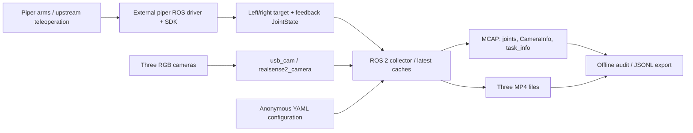

# Piper Dual-Arm Data Collection

[中文说明](README_zh.md) · [Reproduction guide](docs/reproduction.md) · [Code map](docs/core_code_inventory.md) · [Publication review](docs/publication_review.md)

## Project Overview

A ROS 2 recorder for Piper dual-arm teleoperation data: four joint streams, three RGB views, task metadata, and keyboard-controlled episodes. Joint and camera metadata are recorded in MCAP; images are stored as three MP4 videos.

This is a local publication candidate. The collector and camera launch are preserved source snapshots; offline audit and export utilities were added during engineering review. The robot driver, SDK, client validator, models, and datasets are external or excluded. Project ownership and redistribution permission must be confirmed before publication; no project license has been assigned.

## Key Features

- Separate left/right target and feedback streams, preserving ROS joint names and arrays.
- Configurable state/image save timers, latest-message caches, and a callback watchdog.
- Three-camera preview and MPEG-4 video recording.
- Embedded ROS message schemas for offline MCAP interpretation.
- Offline MCAP, CDR, MP4 metadata, timing, numeric-quality, and file-pairing diagnostics.
- JSONL export of original joint arrays and timestamps without relabeling them as training actions.

The recorder does not implement robot motion control, hardware synchronization, automatic recovery, or a LeRobot exporter.

## Piper Dual-Arm Hardware

The documented setup uses two Piper execution arms, each with six rotary joints and a gripper, two logical SocketCAN interfaces, and three RGB cameras. The high camera uses the RealSense ROS driver; the side cameras use usb_cam and are named `dabai_left/right`. Exact arm generation, motor models, camera model numbers, physical teleoperation input devices, and USB topology were not recorded.

Four ROS joint topics do not establish that four physical arms are present. The streams labeled `leader` are readbacks of CAN control targets in the inspected external driver.

## System Architecture



## Robot Communication

The external driver uses a separate SDK instance and CAN interface per execution arm. Expected bitrate is 1,000,000 bit/s. The original interface names are `can_piper_left` and `can_piper_right`; these are logical names, not device identities. Bind and verify each physical side before enabling motors. Both upstream launch defaults may be `can0`, so pass both interfaces explicitly.

`configs/robot.example.yaml` documents this mapping; the collector does not load that file or configure CAN.

## Dual-Arm Control

Motion is handled externally. The recorder subscribes to `/joint_states_ctrl_left/right` and `/joint_states_left/right`. The inspected driver also exposes `/joint_ctrl_cmd_left/right` and `/pos_cmd_left/right`, but this package does not publish to them. There is no atomic dual-arm command, execution barrier, or verified cross-arm stop controller in the recorder.

## Joint State Collection

| Input | MCAP topic | Meaning |
|---|---|---|
| `/joint_states_left` | `/robot/arm_left_follow/joint_states` | Execution feedback |
| `/joint_states_right` | `/robot/arm_right_follow/joint_states` | Execution feedback |
| `/joint_states_ctrl_left` | `/robot/arm_left_leader/joint_states` | CAN target readback |
| `/joint_states_ctrl_right` | `/robot/arm_right_leader/joint_states` | CAN target readback |

Typical position order is `[joint1, joint2, joint3, joint4, joint5, joint6, gripper]`: six angles in radians and one opening in meters. Feedback velocity has six elements; effort commonly has seven. Leader velocity/effort may be zero arrays or empty after historical processing and must not be treated as measured velocity or torque.

The source files contain no unified `state` or `action` column. Concatenating left and right positions would define a downstream 14-element layout, but that transformation is not an existing dataset schema. Effort is SDK current-derived estimation, not proven direct torque sensing.

## Gripper Control

The external driver sends and reads gripper commands. This recorder saves the continuous opening as `position[6]`, not a binary open/closed class. It does not record a separate gripper status code or gripper velocity. Historical leader all-zero filtering holds the previous position with a new message header; held values are not marked in the data.

## Camera Configuration

| View | Driver / device | Launch request | Recording |
|---|---|---|---|
| high | RealSense, exact model unknown | Profile string 1280×720×30; parameter compatibility needs checking | RGB only |
| left | usb_cam `/dev/video0` | 1280×720, 30 FPS, `mjpeg2rgb` | BGR decode → MP4 |
| right | usb_cam `/dev/video2` | 1280×720, 30 FPS, `mjpeg2rgb` | BGR decode → MP4 |

Depth and infrared are disabled in the launch snapshot. Historical files include 848×480, 640×480, and 1280×720 video. The RealSense snapshot uses `depth_module.color_profile`; verify whether your driver accepts it and inspect the actual output. Side-camera calibration must match the real mode. The template matrices are placeholders, not valid calibration.

## Multi-Camera Acquisition

Camera drivers run as separate ROS nodes. The collector uses a default single-threaded spin and performs JPEG decoding, preview, MCAP writes, and three sequential video writes in its callbacks. Each view has a latest-image cache. Frames may be reused when the source is slower than the save timer; there is no dedicated encoding queue or source-frame consumption tracking.

The final visible performance change reduces preview from 30 to 10 Hz and resizes it to 640×360. This reduces GUI work, but is not evidence that physical frame loss is eliminated.

## Timestamp Management

Joint messages retain their headers, while MCAP log/publish times both use the recorder's current ROS clock. The watchdog and callback-rate display use `time.time()`. MP4 uses the configured constant playback rate. Image source headers and frame IDs are not retained alongside video frames.

## Data Synchronization

Four state messages share a save-tick log time; three camera metadata messages are emitted from another timer. This is software resampling of latest values. Side CameraInfo is synthesized from YAML, and its image-header lookup falls back to save time because image callbacks do not cache the original message. Side CameraInfo offsets therefore do not measure exposure synchronization. There is no hardware trigger, device-clock alignment, or guaranteed observation/action latency alignment.

## Episode Management

Run the collector with a reviewed local configuration. Focus a preview window for keyboard input.

| Key | Effect |
|---|---|
| Space | Prepare an episode; wait for four joint streams and a nonzero leader position |
| `s` | Save the current episode |
| `q` | Discard the current episode and delete its files |
| `r` | While idle, permanently delete the preceding episode number |
| `z` | Exit; discard an unfinished episode |

There is no pause/resume. IDs continue after the highest numeric MCAP filename. Reaching `total_sampled_frames` saves automatically. A callback timeout discards the episode; it does not stop the robot. Nonzero static leader positions can trigger recording; this is not a motion-difference detector.

## Dataset Structure

```text
recordings/example_task/
├── record_config.yaml
├── 0.mcap
└── videos/
    └── 0/
        ├── cam_high.mp4
        ├── cam_left.mp4
        └── cam_right.mp4
```

MCAP contains `/task_info`, four JointState topics, and up to three CameraInfo topics. It does not contain the RGB frames. Some historical delivered folders use `<task>/<id>/cam_*.mp4`; the offline audit supports both layouts. Configuration is a dataset-level snapshot that can be overwritten on the next recorder startup.

## Repository Structure

```text
configs/                 Anonymous collection / CAN documentation templates
launch/dualcam.launch.py Original camera launch snapshot
src/piper_collection/
  collector.py           Unchanged original recorder
  diagnostics/           Offline CDR, timing, MP4 and dataset checks
scripts/                 Explicit collection, inspection, audit and JSONL export
tests/                   Synthetic offline tests; no robot connection
docs/                    Architecture, schemas, reproduction and publication review
requirements*.txt        Offline, developer and hardware dependency profiles
```

## Environment Requirements

Live collection requires Ubuntu 22.04, ROS 2 Humble with Python 3.10, standard ROS messages, a GUI-capable OpenCV build/display, MCAP, NumPy, PyYAML, the separately built Piper ROS driver and SDK, usb_cam, RealSense ROS, and compressed image transport. Observed driver versions are listed in [dependencies](docs/dependencies.md); the historical environment export is incomplete and differs from the current environment.

Offline tools need Python 3.10+ and `requirements.txt`; tests also use `requirements-dev.txt`. No ROS or hardware is needed for offline tools.

## Installation

```bash
# Offline environment
python3.10 -m venv .venv
source .venv/bin/activate
python -m pip install -r requirements-dev.txt
python -m pytest -q -p no:cacheprovider tests
```

For live collection, install ROS and the authorized external drivers first, then use a Python 3.10 environment that can access ROS packages. Source `/opt/ros/humble/setup.bash` and the external workspace's `install/setup.bash`. `requirements-hardware.txt` records the historical NumPy/OpenCV pair and observed SDK version; installing it is not a substitute for the ROS workspace or hardware commissioning.

## Hardware Setup

Confirm arm model/firmware, safe power and emergency-stop arrangements, the upstream teleoperation setup, distinct CAN mappings, three camera identities, USB bandwidth, and storage capacity. Camera `/dev/videoN` enumeration is not stable identity. Confirm actual resolution and calibrate side cameras at that resolution. Physical mounting and extrinsic calibration are not supplied.

## Left and Right Arm Initialization

The following is the original operator-run driver workflow. It requests motor/gripper enabling; perform the manufacturer's hardware checks first. This package does not execute it automatically.

```bash
source /path/to/piper_ros/install/setup.bash
ros2 launch piper start_two_piper.launch.py \
  can_left_port:=can_piper_left can_right_port:=can_piper_right \
  auto_enable:=true girpper_exist:=true
```

`girpper_exist` reproduces the upstream launch spelling; the inspected node declares `gripper_exist`. Verify this version-dependent mismatch. The SDK connects and queries limits/firmware; that is not a zero-calibration or homing routine. Inspect all four joint topics before recording.

## Camera Initialization

```bash
ros2 launch ./launch/dualcam.launch.py
ros2 topic hz /dabai_left/image_raw/compressed
ros2 topic hz /dabai_right/image_raw/compressed
ros2 topic hz /camera/camera/color/image_rect_raw/compressed
```

Confirm these exact topics exist; another RealSense configuration may publish `image_raw` instead of `image_rect_raw`. The collector does not create a missing compressed transport. Review a local launch copy if device paths or accepted parameters differ.

## Data Collection Instructions

```bash
cp configs/collection.example.yaml configs/collection.local.yaml
# Edit output path, anonymous task description, frequencies and REAL calibration.
python scripts/collect.py --config configs/collection.local.yaml
```

The example requests 50 Hz state saves, 30 Hz image saves, and 10,000 state batches. Preview uses 10 Hz. Start an episode with Space, operate through the external teleoperation system, and save with `s`. Archive the printed raw callback rates and inspect the resulting files before using them for training. Recording changes no robot control commands itself; external driver enabling has its own effects.

## Data Validation

```bash
python scripts/inspect_mcap.py /path/to/0.mcap --output /tmp/episode-audit.json
python scripts/audit_dataset.py /path/to/dataset-root --output /tmp/piper-audit
python scripts/export_joint_states.py /path/to/0.mcap --output /tmp/joints.jsonl
```

Audits read input files without rewriting them. Inventory covers all MCAP summaries and MP4 tables; deep CDR checks default to first/middle/last per eligible group. JSON reports include dimensions, nonfinite values, duplicate/regressing timestamps, gaps and nearest-neighbor offsets. Inspection exit status indicates structural decoding success, not full training-data acceptance. JSONL output preserves topics and array lengths; it does not fill missing velocity or generate normalized actions.

The client validator is excluded pending permission. Its mandatory checks use camera average-rate tolerance ±0.5 FPS, maximum log gap ≤69 ms, minimum 640×480, header synchronization <34 ms, and joint average >45 Hz. Passing it does not prove physical camera FPS, complete videos, or target freshness. [Audit scope and limitations](docs/data_quality_scope.md) explain the difference.

## Troubleshooting

| Symptom | Check |
|---|---|
| Only one arm / wrong side | Distinct CAN arguments, physical binding, remapped topics |
| Waiting indefinitely | Four joint topics, leader nonzero values, missing camera/CameraInfo topics |
| Resolution or header unavailable offline | MCAP embedded schema; old files may have empty schema text |
| Camera FPS warnings | Source callback rate vs save rate; GUI, JPEG decode, encoding, USB/CPU load |
| MP4 shows 30 FPS but looks frozen | Latest cache may repeat frames; MP4 rate is playback metadata |
| H.264 unavailable | Recorder uses mp4v; codec availability and later transcoding are separate issues |
| Video empty/truncated | Writer availability and clean shutdown; never treat file existence as integrity |
| ROS import error | Python 3.10 / Humble ABI and sourced environments |

See [camera debugging](docs/camera_frame_rate_review.md) for the evidence behind the final preview optimization.

## Safety Considerations

Use the manufacturer's commissioning and emergency-stop procedures. The external launch can enable motors and command the gripper. The recorder's timeout only discards files and is not a robot emergency stop. `q`, `r`, and an unfinished exit delete recordings. No hardware movement or complete live collection was executed during this audit.

## Limitations

Exact hardware variants, deployment revision and full historical environment remain unconfirmed. The recorder has no hardware sync, bounded encoding queue, image timestamp sidecar, explicit action schema, collision avoidance, cross-arm execution acknowledgment, transactional episode commit, or comprehensive automatic recovery. Historical data mixes 50/100 Hz state saves and processed/raw fields. Live hardware reproduction has not been tested by this release preparation.

## Dependencies and Acknowledgements

Piper SDK and ROS driver: AgileX Robotics; ROS 2 standard messages and launch; usb_cam, RealSense ROS and image transport; MCAP and ROS decoding support; NumPy, PyYAML, OpenCV, and pytest. SDK/driver sources, models, client code, private data, and environment archives are not vendored. Consult [dependencies](docs/dependencies.md), [source manifest](docs/source_manifest.json), and [publication review](docs/publication_review.md) before deciding on a project license or public upload.
