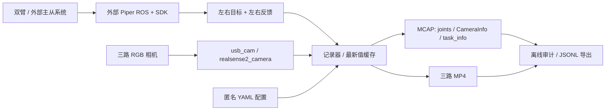

# Piper 双臂数据采集工程

[English](README.md) · [复现指南](docs/reproduction.md) · [代码清单](docs/core_code_inventory.md) · [授权待确认](docs/publication_review.md)

## 项目概览

基于 ROS 2 的 Piper 双臂数据记录器，接收左右两侧目标与反馈共四路关节消息、三路 RGB 视角和任务描述。机器人及相机元数据保存在 MCAP，图像另存三路 MP4，通过键盘管理 Episode。

这是本地整理的公开候选包。采集器与相机 launch 保留原样，新增离线审计和原数组导出工具。Piper ROS 驱动、SDK、甲方校验器、模型与数据未打包。项目版权、合同限制和公开授权仍需权利人确认，未擅自添加开源 LICENSE。

## 主要功能

- 分别保留左/右目标和反馈的 JointState、关节名称及原始数组长度。
- 配置状态/图像保存定时器、最新值缓存、回调超时检查。
- 三相机预览、MPEG-4 视频与带 ROS 消息 Schema 的 MCAP。
- 空间占用、文件配套、时间间隔、重复/逆序时间戳、数值与维度离线审计。
- JSONL 导出原关节数组与时间，不自动归一化或重标为训练 Action。

采集器没有机器人运动控制、硬件同步、自动恢复或 LeRobot 转换功能。

## Piper 双臂硬件

可确认左右两个执行侧，每侧六旋转关节与夹爪；两个逻辑 SocketCAN 接口；顶部 RealSense 驱动相机、左右 usb_cam 相机（命名 dabai）。具体 Piper 代次、电机、相机型号、USB 拓扑、主臂/操作设备型号待确认。四路状态话题不等于已证明四台物理机械臂：leader 流来自外部驱动读回 CAN 控制目标。

## 系统架构



## 机器人通信

外部驱动每侧一个 SDK 实例和 CAN 接口，预期1000000 bit/s。原操作流程使用 `can_piper_left` 与 `can_piper_right`；它们是逻辑接口名，不是设备身份。必须核实物理侧与接口对应；外部双臂 launch 两个默认值可能都是 `can0`，需要分别传参。

`configs/robot.example.yaml` 只是文档模板，不由采集器读取，也不会配置 CAN。

## 双臂控制

机械运动由外部系统完成。记录器订阅 `/joint_states_ctrl_left/right` 和 `/joint_states_left/right`，不向外部驱动的 `/joint_ctrl_cmd_left/right` 或 `/pos_cmd_left/right` 发布指令。包内没有统一双臂命令、执行同步屏障或联动停机控制器。

## 关节状态采集

| ROS 输入 | MCAP 输出 | 含义 |
|---|---|---|
| `/joint_states_left` | `/robot/arm_left_follow/joint_states` | 左执行反馈 |
| `/joint_states_right` | `/robot/arm_right_follow/joint_states` | 右执行反馈 |
| `/joint_states_ctrl_left` | `/robot/arm_left_leader/joint_states` | 左目标读回 |
| `/joint_states_ctrl_right` | `/robot/arm_right_leader/joint_states` | 右目标读回 |

每侧 position 一般为 `[joint1..joint6,gripper]`，前六项 rad，夹爪 m；反馈 velocity 为6维，effort常为7维。SDK effort 是电流系数估算量，不能称为独立传感器测得的精确关节扭矩。leader velocity/effort 是零数组或后处理后的空数组，不是实测值。

原文件没有统一的 state/action 列。若下游定义左7+右7为14维，需要单独明确映射；当前导出工具保留四路结构和空数组，不自动补维。

## 夹爪控制

外部驱动负责夹爪指令与反馈，本记录器只保存 `position[6]` 连续开口，不采用0/1编码，没有独立夹爪速度或状态码。leader全零过滤可能使用新header配旧位置，数据中没有保持标记。

## 相机配置

| 视角 | 驱动 / 映射 | launch请求 | 保存 |
|---|---|---|---|
| high | RealSense，具体型号未知 | profile字符串1280×720×30，参数兼容性待核实 | 仅RGB |
| left | usb_cam `/dev/video0` | 1280×720 / 30FPS / mjpeg2rgb | BGR解码后MP4 |
| right | usb_cam `/dev/video2` | 同左 | 同左 |

深度/红外关闭。历史真实视频包含848×480、640×480、1280×720，不能把当前配置当作全部历史数据尺寸。RealSense快照使用 `depth_module.color_profile`，需要确认驱动是否接受。左右相机必须使用真实模式下的标定；模板单位阵是占位值，不能直接用于训练数据采集。

## 多相机采集

相机驱动各自运行；记录器使用默认单线程spin，JPEG解码、GUI、MCAP及三路视频串行写入共享回调执行时间。每路仅存最新画面，无独立编码队列或源帧消耗标记。源图像变慢时可能重复保存旧画面。

当前相对最后备份的性能改动为预览30→10Hz、缩至640×360，可降低GUI开销；没有证据证明物理掉帧已经全部消失。

## 时间戳管理

JointState保留消息header；MCAP log_time和publish_time均为记录器当前ROS时间。超时与Raw回调率使用 `time.time()`。MP4按配置恒定FPS生成播放时间轴，图像原始header和帧序号没有配套保存。

## 数据同步

四状态共享一个保存tick的log_time，三路CameraInfo由另一个定时器发出。左右info按YAML合成，取图像header的分支因未缓存原消息而回退到保存时间，不能用它证明相机曝光同步。没有硬件触发、设备时钟对齐或明确的Observation/Action延迟补偿。

## Episode 管理

请将键盘焦点放在预览窗口。

| 按键 | 行为 |
|---|---|
| 空格 | 预备，四路状态齐且任一leader非零后开始 |
| `s` | 保存当前片段 |
| `q` | 舍弃并删除当前片段文件 |
| `r` | 空闲时永久删除前一个编号 |
| `z` | 退出，舍弃未完成片段 |

没有暂停/恢复。编号从已有数字MCAP最大值+1继续；达到状态帧数上限自动保存；话题回调超时会舍弃记录，不会停止机器人。非零静止姿态也可能触发，不是相邻位置变化检测。

## 数据集结构

```text
recordings/example_task/
├── record_config.yaml
├── 0.mcap
└── videos/0/
    ├── cam_high.mp4
    ├── cam_left.mp4
    └── cam_right.mp4
```

MCAP通常为task_info、四JointState、三CameraInfo；不含RGB图像。历史交付目录也有 `<task>/<id>/cam_*.mp4`，离线工具支持两种布局。record_config是数据集级文件，下次启动可能被覆盖，不是每Episode不可变配置。

## 仓库结构

```text
configs/                  匿名采集 / CAN说明模板
launch/dualcam.launch.py  原相机启动快照
src/piper_collection/
  collector.py            原样采集器
  diagnostics/            离线CDR、时间、MP4及数据审计
scripts/                 采集、检查、审计、JSONL导出入口
tests/                   不连接机器人的合成离线测试
docs/                    架构、字段、复现及公开审核
requirements*.txt        离线/开发/硬件依赖配置
```

## 环境要求

实时采集：Ubuntu22.04、ROS2 Humble / Python3.10、标准消息、带GUI的OpenCV与显示环境、MCAP/NumPy/PyYAML、独立构建的Piper ROS与SDK、usb_cam、RealSense ROS和compressed image transport。版本及环境差异见 [依赖说明](docs/dependencies.md)。

离线工具只需要Python3.10+和requirements.txt，测试再安装requirements-dev.txt，不要求ROS或任何硬件。

## 安装

```bash
python3.10 -m venv .venv
source .venv/bin/activate
python -m pip install -r requirements-dev.txt
python -m pytest -q -p no:cacheprovider tests
```

硬件侧先安装ROS和经过授权的外部驱动，使用能访问ROS包的Python3.10环境，source ROS及外部工作区setup。requirements-hardware.txt记录历史NumPy/OpenCV配对及当前可观测SDK版本，不替代ROS构建与硬件初始化，也不表示本次已完成实时硬件验证。

## 硬件连接

按厂商流程检查型号/固件、供电、急停、上游主从系统、CAN左右身份、三相机身份和USB带宽。`/dev/videoN` 不是固定身份。核实实际输出分辨率并重新标定；包内不提供真实外参、设备串号或私人USB端口映射。

## 左右臂初始化

以下是原工作流的操作者手动命令，会请求电机/夹爪使能，执行前完成真实机械安全检查。包内不会自动调用它。

```bash
source /path/to/piper_ros/install/setup.bash
ros2 launch piper start_two_piper.launch.py \
  can_left_port:=can_piper_left can_right_port:=can_piper_right \
  auto_enable:=true girpper_exist:=true
```

`girpper_exist`沿用原launch拼写，驱动实际声明 `gripper_exist`，需要检查版本和参数覆盖。SDK连接后的限制/固件查询不是零位标定或回零。检查四路状态以及真实左右映射后再采集。

## 相机初始化

```bash
ros2 launch ./launch/dualcam.launch.py
ros2 topic hz /dabai_left/image_raw/compressed
ros2 topic hz /dabai_right/image_raw/compressed
ros2 topic hz /camera/camera/color/image_rect_raw/compressed
```

确认这些精确话题都存在。有的RealSense配置只发布 `image_raw`，记录器不会自动生成缺失压缩话题。设备路径、profile参数或话题不同，应审查并调整本地launch副本。

## 数据采集步骤

```bash
cp configs/collection.example.yaml configs/collection.local.yaml
# 编辑目录、匿名任务、频率和真实相机标定。
python scripts/collect.py --config configs/collection.local.yaml
```

模板请求状态50Hz、图像30Hz、10000状态批次上限；预览10Hz。空格预备，经外部主从系统操作，s保存。保存终端打印的Raw回调频率，随后检查文件。采集器本身不发送机械动作，上游驱动使能的实际效果独立于记录操作。

## 数据验证

```bash
python scripts/inspect_mcap.py /path/to/0.mcap --output /tmp/episode-audit.json
python scripts/audit_dataset.py /path/to/dataset-root --output /tmp/piper-audit
python scripts/export_joint_states.py /path/to/0.mcap --output /tmp/joints.jsonl
```

输入只读。全量检查摘要和视频样本表，默认每组首/中/尾做深度CDR检查。JSON含维度、NaN/Inf、重复/逆序、间隔和最近邻偏差。inspect退出码表示结构/解码成功，不代表全面训练质量合格；export保留话题和空数组，不自动生成Action。

甲方校验器未获再分发确认，未纳入包。其mandatory阈值包括FPS偏差±0.5、最大log gap≤69ms、尺寸≥640×480、header同步<34ms及joint平均>45Hz；通过不能保证曝光帧率、视频完整或目标新鲜度。见 [审计口径](docs/data_quality_scope.md)。

## 常见问题排查

| 问题 | 检查方向 |
|---|---|
| 只有一侧/左右错 | 显式CAN参数、真实设备绑定、remap话题 |
| 一直等待 | 四状态、非零leader、三相机和high info是否到达 |
| 离线无尺寸/header | 是否嵌入完整ROS schema；旧数据可能为空 |
| 帧率告警 | 源回调与保存频率分别测；GUI、JPEG、编码、USB/CPU |
| MP4是30FPS但画面停住 | 缓存可能重复，容器FPS不代表曝光FPS |
| H.264不可用 | 在线采用mp4v；后转码是另一处理步骤 |
| 空/截断视频 | writer可用性、正常关闭；存在文件不等于完整 |
| ROS导入失败 | Python3.10/Humble ABI及source环境 |

相机问题证据复盘见 [camera_frame_rate_review.md](docs/camera_frame_rate_review.md)。

## 安全注意事项

遵守厂商初始化、工作空间与急停流程。外部launch可以使能电机并改变夹爪状态。记录器的超时处理只舍弃文件，不是硬件急停。q/r/未完成退出会删除记录。本次整理没有启动真实机械动作或完整在线采集。

## 当前局限

硬件子型号、实际部署提交、完整历史环境待确认；没有硬件同步、有界编码队列、图像时间戳sidecar、明确训练Action列、碰撞规避、双侧执行确认、跨文件原子提交或完整自动恢复。历史数据混有50/100Hz、原始/后处理版本。本次只验证离线能力，没有完成硬件复现。

## 依赖与致谢

AgileX Piper SDK/ROS、ROS2标准消息与launch、usb_cam、RealSense ROS、image transport、MCAP/ROS解码支持、NumPy、PyYAML、OpenCV及pytest。未内置SDK/驱动/模型/甲方代码、私人数据或环境归档。公开前审查 [依赖](docs/dependencies.md)、[来源清单](docs/source_manifest.json) 和 [授权事项](docs/publication_review.md)，由权利人决定项目许可证。
