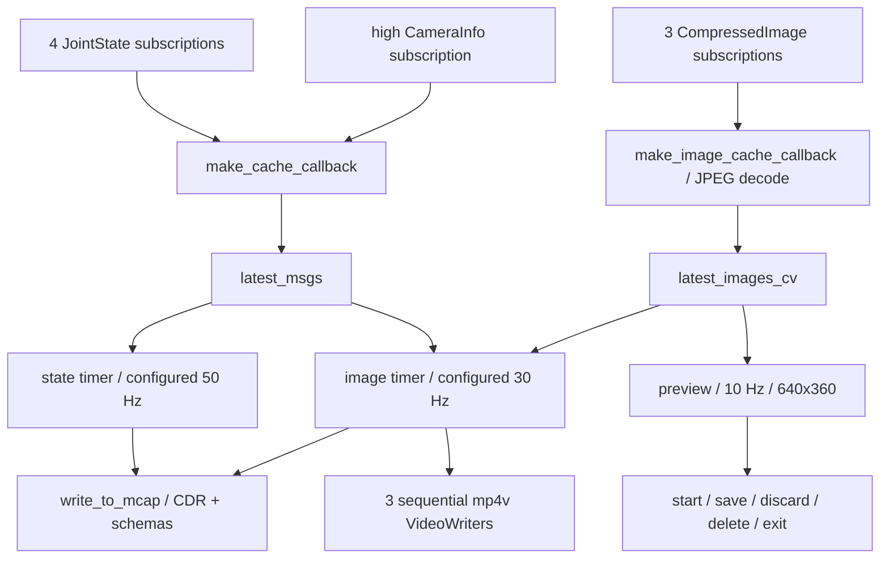

# Architecture and implementation boundaries

The source recorder is `src/piper_collection/collector.py`, copied unchanged from the reviewed project's `collection.py`. `scripts/collect.py` adds an explicit configuration argument and cleanup wrapper. Neither file starts a CAN driver or sends robot motion commands.

Two external Piper ROS nodes expose four JointState streams: left/right execution feedback and left/right CAN target readbacks. Two usb_cam nodes and a RealSense node expose compressed RGB streams; high CameraInfo is subscribed separately. `launch/dualcam.launch.py` preserves the original camera launch, including device assumptions that require operator review.

The recorder uses a default single-threaded ROS spin. Camera drivers have separate processes, while JPEG decode, preview and encoding share the recorder's callback execution time. Latest-value caches bound memory but can repeat stale values. There is no message timestamp matcher, dedicated encoding queue, hardware synchronization or unified dual-arm control object.

The SDK/driver implements CAN access, enabling, joint/gripper commands, feedback conversion and internal communication threads. Those components are external dependencies, not implementations authored by this recorder project. Four topics do not prove four physical arms or identify the upstream teleoperation apparatus.

Source-version review found six collector snapshots. The last snapshot-to-current change reduces preview from 30 to 10 Hz and resizes the display. A prior change embeds complete ROS schemas; older snapshots have empty schema data. No usable project Git object history was available, so commit authors/dates and the exact deployed revision remain unconfirmed.

See [state/action semantics](state_and_action.md), [timing](timestamp_and_synchronization.md), and [camera review](camera_frame_rate_review.md).
