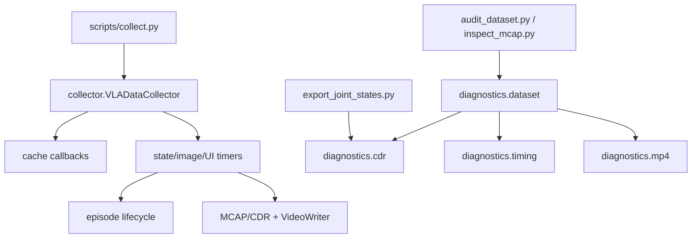

# Code inventory and call relationships

| File | Provenance | Inputs → outputs | Runtime |
|---|---|---|---|
| src/piper_collection/collector.py | Unchanged collection.py snapshot | YAML/ROS messages/keys → MCAP, MP4, preview | ROS + camera/robot streams + GUI |
| launch/dualcam.launch.py | Unchanged source snapshot | Fixed device assumptions → external camera nodes | Cameras + ROS drivers |
| scripts/collect.py | New small entry wrapper | Explicit --config → original collector | Live ROS |
| diagnostics/cdr.py | New | Classic ROS CDR → JointState fields / CameraInfo prefix | Offline |
| diagnostics/timing.py | New | Timestamp arrays → interval/order/nearest-offset statistics | Offline, NumPy |
| diagnostics/mp4.py | New | MP4 atom/sample tables → dimensions/codec/count/rate | Offline, standard library |
| diagnostics/dataset.py | New | Dataset paths → inventories, deterministic samples, JSON/CSV | Offline, mcap + NumPy |
| scripts/audit_dataset.py | New | Root and output directory → dataset audit | Offline |
| scripts/inspect_mcap.py | New | One MCAP → structural and deep numeric report | Offline |
| scripts/export_joint_states.py | New | One MCAP → original joint arrays/time JSONL | Offline |
| tests/test_offline.py | New | Synthetic CDR/MCAP/MP4 cases → assertions | Offline, no device access |

Paths beginning `diagnostics/` are under `src/piper_collection/`. `configs/collection.example.yaml` contains anonymous task placeholders and identity calibration matrices; `robot.example.yaml` only documents external CAN mapping.

Collector functions retain their original organization: `__init__` configures mappings, caches, subscriptions and timers; `make_cache_callback` implements target holding and source counters; `make_image_cache_callback` decodes pixels; state/image timer callbacks save latest values; `ui_loop` handles preview/keys; start/save/discard/remove/close manage files; `write_to_mcap` embeds schemas and serializes ROS messages.

There are no fabricated robot, communication or dual-arm-control implementations in this package. CAN connection, enabling, status reads and actuator commands belong to external Piper ROS/SDK dependencies. The inspected external driver uses `C_PiperInterface`, `ConnectPort`, `GetArmJointMsgs`, `GetArmJointCtrl`, `GetArmGripperMsgs`, `JointCtrl` and `GripperCtrl`; no SDK source is vendored.

The original client validator, historical repair tools, six backup collectors, URDF/meshes, calibration reports, environments and data are excluded. `source_manifest.json` records original-to-package mapping, byte hashes and generated-file provenance. Project-source ownership still requires confirmation.
